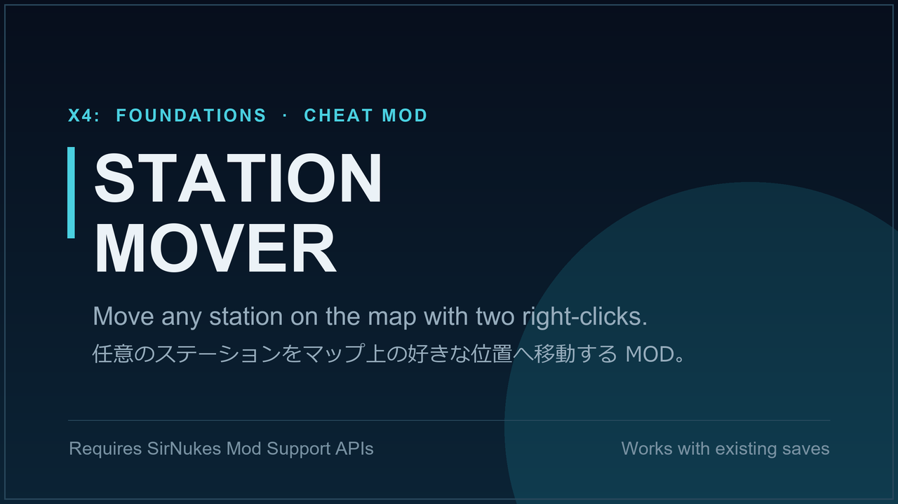

# Station Mover (X4: Foundations)

Move any station to a new position on the map with two right-clicks. Useful when the AI builds stations hundreds of km outside the sector core.

**Steam Workshop:** https://steamcommunity.com/sharedfiles/filedetails/?id=3779666154

## Features

- Right-click any station (yours, NPC or enemy) and choose "Move station..." to arm move mode.
- Right-click an empty spot on the map, in the same or any other sector, and choose the "Move here:" entry showing the station's name. The station is teleported there instantly, together with its build storage, and keeps its orientation.
- The destination height is set to 0 (the ecliptic plane), matching the flat map view.
- Need a specific height? Drop a nav beacon at the exact spot, then right-click **your** beacon while move mode is armed and choose "Move here (at beacon)". The station arrives at the beacon's exact position, height included, and the beacon is consumed.
- Arming move mode deselects the station, so the next right-click on the map directly shows the normal context menu with the "Move here:" entry.
- While move mode is armed, a "Cancel station move" entry appears in every right-click menu.

### Notes

- Docked ships move together with the station; ships flying towards it simply head for the new position.
- The build plot of player-built stations is not moved.
- Moving stations that are part of an active mission may affect mission progress.
- Moves are written permanently into your savegame. The mod can be removed at any time: stations stay where you put them, and your save loads fine without the mod.
- Only stations can be moved. Jump gates are intentionally not supported: moving one to another sector would rewire the galaxy's gate connections permanently, and several storylines rely on gates staying in their sectors.
- Languages: English, Japanese and Russian (other languages fall back to English).

## Requirements

- X4: Foundations 7.00 or later
- [SirNukes Mod Support APIs](https://steamcommunity.com/sharedfiles/filedetails/?id=2042901274)

As an unsigned script mod, the game runs in [Modified] mode while it is active.

## Installation

- **Steam Workshop:** subscribe on the Workshop page above.
- **Manual:** copy `content.xml`, `ui.xml`, `md/`, `t/` and `ui/` into `X4 Foundations/extensions/x4_station_mover/`.

## How it works

- The move itself is the vanilla MD action `<warp>` with a sector-space position (the game creates a temporary zone when needed). The station's build storage is warped along, keeping its relative offset. Both keep their orientation: it is read in sector space before the move and passed to `<warp>` explicitly.
- The right-click entries are added through the SirNukes Interact Menu API.
- `ui/x4sm_deselect.lua` (registered by `ui.xml`) clears the map selection when move mode is armed, so the next right-click opens the normal context menu.
- All logic lives in `md/X4_Station_Mover.xml`; texts are in `t/` (page 9004231; `0001.xml` is the fallback for languages without their own file).

## Contributing

Issues and pull requests are welcome. There is no build step: the mod is plain MD script XML plus one small Lua file.

To test changes, copy the files into your `extensions` folder as described above. If you are also subscribed on the Workshop, disable that copy while testing so the game does not load two mods with the same ID. Starting X4 with `-debug all -logfile debuglog.txt` writes script errors to `Documents/Egosoft/X4/<id>/debuglog.txt`.

Code comments are mostly in Japanese; English comments in contributions are perfectly fine.

## Credits

- Orientation preservation and the Russian translation were contributed by KroshkaRoo ([#1](https://github.com/lushunm/x4-station-mover/issues/1)).

## License

[MIT](LICENSE). This covers the files in this repository only.

X4: Foundations is a trademark of Egosoft GmbH. This is an unofficial fan-made mod and is not affiliated with or endorsed by Egosoft.

## 日本語

右クリック2回で任意のステーションをマップ上の好きな位置へ移動する MOD です。移動先の高さは0に揃えられ、ナビビーコンを使えば高さ込みで指定できます。向きは移動前のまま保たれます。英語・日本語・ロシア語に対応しています（ロシア語と向きの保持は KroshkaRoo 氏の寄稿）。詳しくは Steam Workshop のページ（日本語の説明あり）をご覧ください。Issue やプルリクエストは日本語でも歓迎です。
